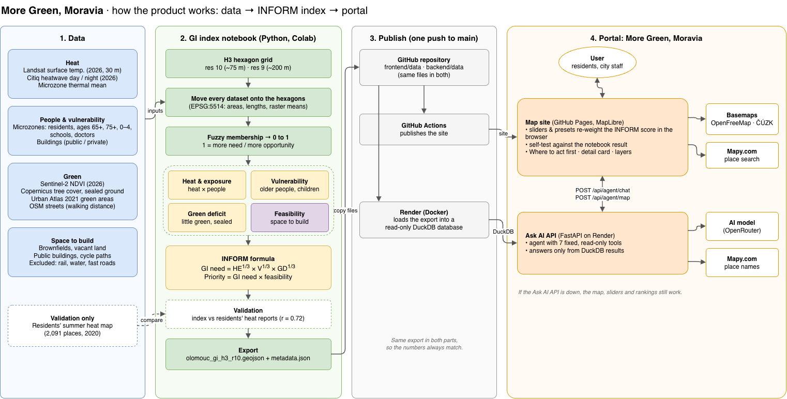

<p align="center">
  
</p>

<p align="center">
  <b>Where would green improvements in Olomouc reduce heat stress for the people most affected?</b>
</p>

<p align="center">
  <a href="https://vickystickz.github.io/more-green-moravia/"><b>Live app</b></a> ·
  <a href="https://more-green-moravia-1.onrender.com/docs#/"><b>API docs</b></a> ·
  <a href="https://canva.link/tnht7nbasr9xogi"><b>Presentation</b></a> ·
  <a href="https://www.figma.com/design/jNJfXOIdk42ymHcyNrZgzg/Hackathon-UI"><b>Figma design</b></a>
</p>

---

More Green, Moravia is an interactive map for residents, planners and the city of Olomouc. It scores every part of the city (H3 hexagons of about 75 m) on three things, following the [INFORM Risk Index](https://drmkc.jrc.ec.europa.eu/inform-index/INFORM-Risk/Methodology) method:

- **Heat & people exposed**: how hot a place gets, and how many people live or spend the day there
- **Vulnerable groups**: older residents, young children, schools, kindergartens and doctors
- **Lack of green**: little vegetation or tree cover, a lot of sealed ground, a long walk to a park

You choose how much each factor matters, and the map, the ranking and the detail card update straight away. An **Ask AI** assistant answers questions about the index ("Where are the warmest nights?", "Which roofs could be greened?") and draws its answers on the map.

Built by **Team deCoDE** (Victor, Pamela and Redoy) for the [UPOL Hackathon 2026](https://hackathon.upol.cz/en/), topic *Smart City in Data: Assessing Quality of Life in Olomouc's Micro-zones Using Sensor Data*.

> **Provisional results.** This version focuses on heat stress. Use the scores as a guide, not a final decision.

## Links

| What | Link |
| --- | --- |
| Web app (GitHub Pages) | [vickystickz.github.io/more-green-moravia](https://vickystickz.github.io/more-green-moravia/) |
| Backend API (Render) | [more-green-moravia-1.onrender.com/docs](https://more-green-moravia-1.onrender.com/docs#/) |
| Presentation | [PRESENTATION_URL](https://canva.link/tnht7nbasr9xogi) |
| UI design (Figma) | [Hackathon UI mock-up](https://www.figma.com/design/jNJfXOIdk42ymHcyNrZgzg/Hackathon-UI) |

The backend runs on Render's free plan, so the first Ask AI request after a quiet period can take up to a minute while the service wakes up.

## How it works



1. **Data.** Heat, population, green space and land-use data for Olomouc are collected in a [shared Google Drive folder](https://drive.google.com/drive/folders/1JooPXrSdxlkH4-JDadWjB4I6fXHUZwjf?usp=sharing).
2. **Pipeline.** A Jupyter notebook moves every dataset onto the same H3 hexagon grid, turns each indicator into a 0–1 score and combines them with the INFORM formula.
3. **Publish.** The notebook's GeoJSON export is copied to the frontend and the backend, so both show the same numbers.
4. **Portal.** The website re-weights the score in the browser as you move the sliders. Ask AI answers questions from the same data.

## Repository layout

```
more-green-moravia/
├── pipeline/                 GI index notebook, input data and method documentation
│   ├── olomouc_gi_v8.ipynb
│   ├── data/                 raw inputs (rasters, GeoJSON, Parquet)
│   └── documentation/        cell guide, data inventory, flow diagram
├── frontend/                 the map site (plain HTML/JS, no build step), deployed to GitHub Pages
├── backend/                  Ask AI API (FastAPI + DuckDB), deployed to Render
├── .github/workflows/        GitHub Pages deploy
└── render.yaml               Render Blueprint for the backend
```

## Pipeline

[pipeline/olomouc_gi_v8.ipynb](pipeline/olomouc_gi_v8.ipynb) builds the index. It:

1. builds an H3 grid over the Olomouc microzones (resolution 9, then resolution 10),
2. transfers every input onto the hexagons (rasters, points, lines, polygons, microzone tables),
3. normalises each indicator to 0–1 with fuzzy membership functions (1 = more need or more opportunity),
4. combines indicators into components and dimensions,
5. checks the result against residents' summer heat map,
6. exports one table keyed by `h3_index` (CSV, GeoPackage, GeoJSON) plus a metadata JSON.

```
Heat_E        = heat^a * exposure^(1-a)
Green deficit = weighted mean(green supply deficit, access deficit)
Vulnerability = weighted mean(share 65+, share 75+, share 0-4, sensitive facilities)
Feasibility   = weighted fuzzy OR(opportunity land, corridors, buildings) x (1 - constraint share)
GI Need       = Heat_E^w1 * Vulnerability^w2 * GreenDeficit^w3
GI Priority   = GI Need * Feasibility
```

**Run it:** open the notebook (it was written for Google Colab with the [data on Google Drive](https://drive.google.com/drive/folders/1JooPXrSdxlkH4-JDadWjB4I6fXHUZwjf?usp=sharing)), set the paths in the configuration cell (section 1), and run all cells. Run it at `h3_res = 9` first, then at `h3_res = 10`, because resolution 10 takes people and vulnerability from the resolution-9 parent hexagons. The first cell installs the dependencies:

```sh
pip install geopandas "h3>=4" rasterio pyproj scipy networkx matplotlib
```

The [documentation](pipeline/documentation/) folder has a cell-by-cell guide to the notebook, the data inventory and the infrastructure diagram.

### Data

The input data is too large for the repository and is shared on [Google Drive](https://drive.google.com/drive/folders/1JooPXrSdxlkH4-JDadWjB4I6fXHUZwjf?usp=sharing). Download the folder into `pipeline/data/` (or mount it in Colab) and point the configuration cell at it. It holds:

| File | What it is |
|---|---|
| `microzones.geojson` | Olomouc microzones: population, age groups, facilities, thermal mean (the only required input) |
| `LST_landsat_microzone_EPSG5514.tif` | Landsat land surface temperature, summer 2026, 30 m |
| `HWmax_T_C.tif`, `HWmin_T_C.tif` | Citiq heatwave day maximum and night minimum air temperature (2026) |
| `NDVI_microzone_EPSG5514.tif` | Sentinel-2 vegetation index (NDVI), summer 2026 |
| `copernicusTreeCoverDensity10m.tif` | Copernicus Tree Cover Density, 10 m |
| `olumouc2024_imperviousness*.tif` | Copernicus Imperviousness Density, 10 m, 2024 |
| `UrbanAtlas2021_microzone_EPSG5514.geojson` | Copernicus Urban Atlas 2021 land use |
| `buildings_with_class.geojson` | Building footprints with use class (residential, public, …) |
| `roads.geojson` | OpenStreetMap streets, for walking distance to green |
| `cycle_path.geojson` | City cycle paths |
| `brownfields_mz.geojson` | City brownfields |
| `olomoucky_kraj.parquet` | Olomouc region source layer |
| `pocitova-teplotni-mapa-olomouce-2.geojson` | Residents' summer heat perception map (2,091 places), used only for validation |

All area and distance work is done in S-JTSK / Krovak East North (EPSG:5514).

## Frontend

The site in [frontend/](frontend/) is plain HTML, CSS and ES modules with MapLibre, in English and Czech. It reads the notebook export from `frontend/data/` (`olomouc_gi_h3_r10.geojson` and its metadata; paths in `DATA_PATHS` in `frontend/js/config.js`).

```sh
cd frontend
cp js/env.example.js js/env.js   # set MAPY_API_KEY (search) and AGENT_API_URL (Ask AI)
python3 -m http.server 5500      # open http://localhost:5500
```

Every push to `main` deploys the site to GitHub Pages ([deploy.yml](.github/workflows/deploy.yml)). The workflow writes `env.js` from the repository secret `MAPY_API_KEY` and the variable `AGENT_API_URL`, and builds the `/en/` and `/cz/` language pages.

## Backend

The Ask AI service in [backend/](backend/) is a FastAPI app. On start it loads the notebook export into DuckDB. A language model answers questions by calling typed tools (`rank_areas`, `area_detail`, …) that run parameterized SQL, so the model never writes SQL and only reads the index data. Answers come with map layers.

```sh
cd backend
uv sync                                  # Python 3.12+
cp .env.example .env                     # set AI_BASE_URL, AI_API_KEY, AI_MODEL
uv run uvicorn app.main:app --reload     # http://localhost:8000/docs
uv run pytest                            # tests
```

It works with any OpenAI-compatible API that supports tool calling, or with the Claude API directly (`AI_PROVIDER=anthropic`). It deploys to Render from [render.yaml](render.yaml). See [backend/README.md](backend/README.md) for the endpoints, configuration and deployment.

## Updating the data

After a new notebook run:

1. Copy `olomouc_gi_h3_r10.geojson`, `olomouc_gi_h3_r10_metadata.json` (and the r9 files) to `frontend/data/` and `backend/data/`.
2. Bump the `?v=` number in `DATA_PATHS` in `frontend/js/config.js` so browsers fetch the new file.
3. Rebuild the backend database: `cd backend && uv run python -m app.ingest --force`.
4. Push to `main`. GitHub Pages and Render redeploy on their own.

## Data sources

| Topic | Data |
|---|---|
| Heat | Landsat surface temperature (summer 2026, 30 m) · Citiq heatwave day and night temperatures (2026) · microzone thermal mean |
| People | Olomouc microzones: residents, ages 65+, 75+, 0–4 · schools, kindergartens, doctors |
| Green | Sentinel-2 NDVI (summer 2026) · Copernicus Tree Cover Density (10 m) · Copernicus Imperviousness (10 m, 2024) · Copernicus Urban Atlas 2021 · OpenStreetMap streets |
| Space to build | Brownfields · vacant land · parking · public buildings · cycle paths |
| Validation | Residents' summer heat map (2,091 places, 2020) · ČÚZK orthophoto |
| Map | OpenFreeMap · ČÚZK orthophoto · Mapy.com search |

**Limits.** People and vulnerable groups are counted per microzone (about 200 m), so neighbouring 75 m hexagons share those values. Flood risk and traffic pollution are not included. The score shows where green would help most; it is not a design or a cost plan. Green roof costs are rough estimates from published price ranges.
